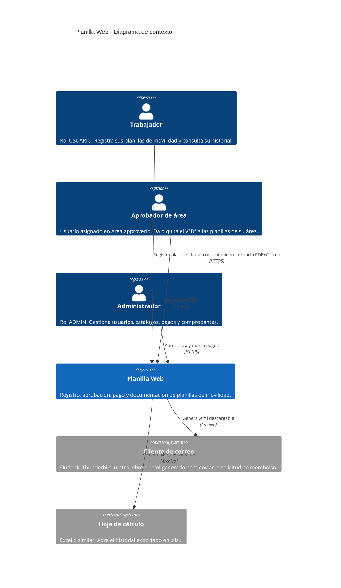
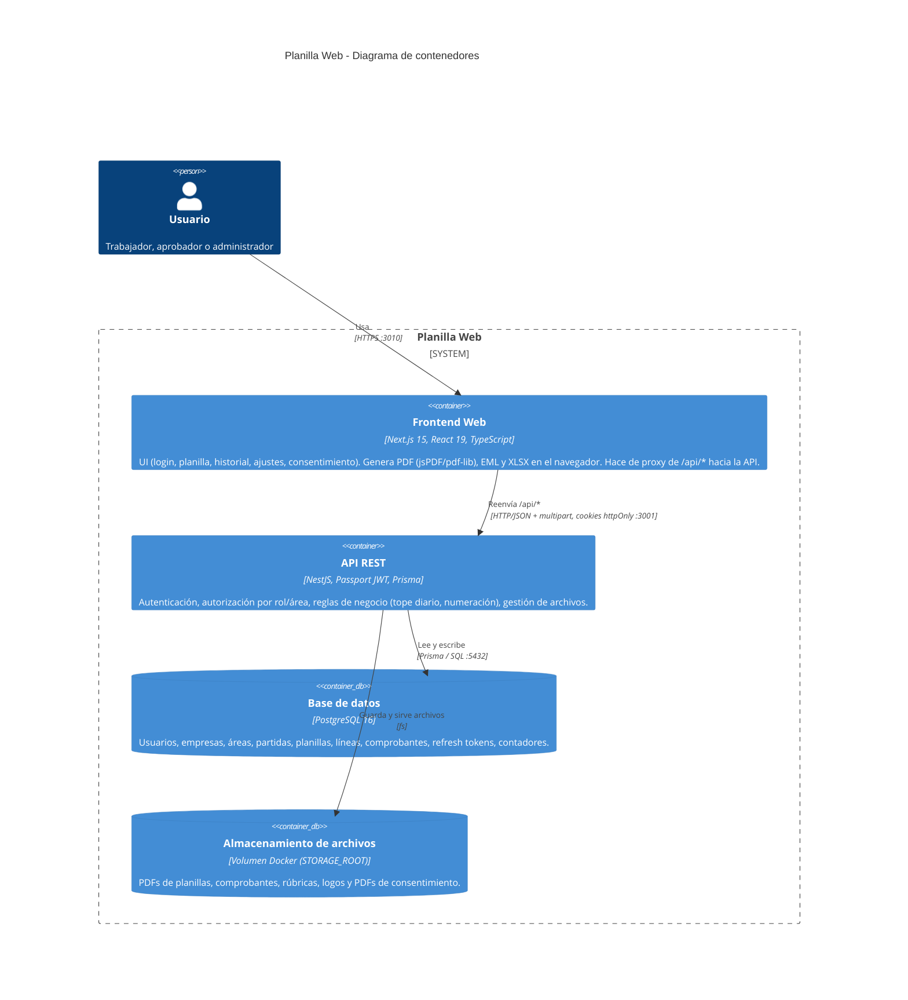
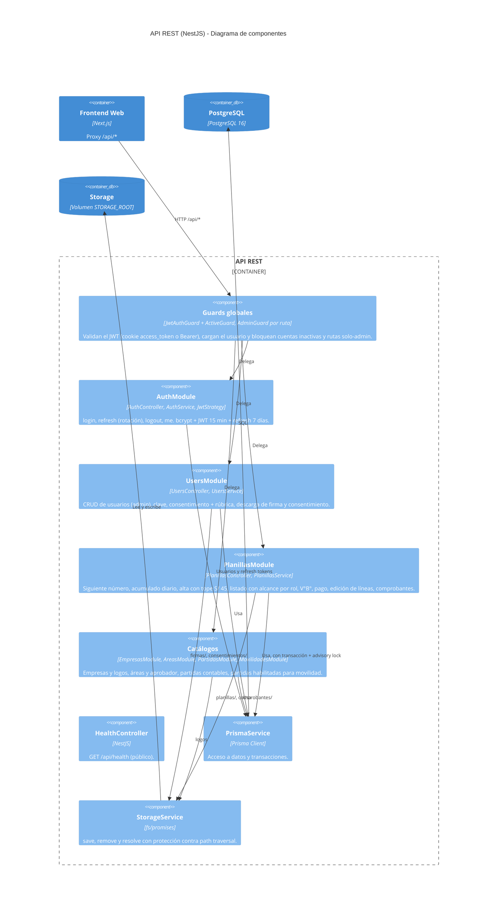
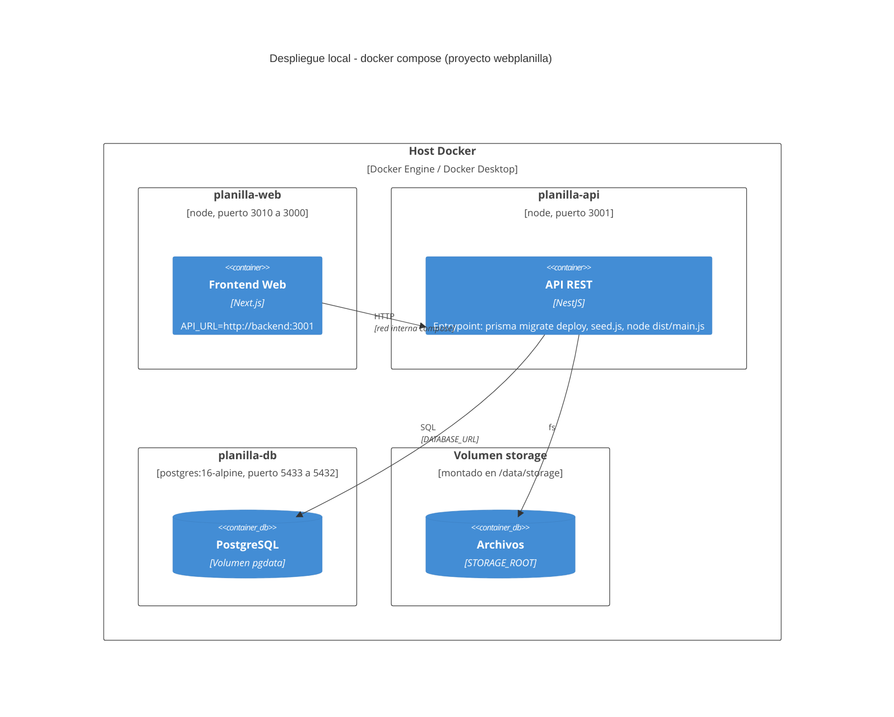

# Arquitectura C4

Modelo C4 de **Planilla Web**: el sistema interno para registrar planillas de movilidad, aprobarlas por área (V°B°), controlar pagos y adjuntar comprobantes.

- [Nivel 1: Contexto](#nivel-1-contexto)
- [Nivel 2: Contenedores](#nivel-2-contenedores)
- [Nivel 3: Componentes de la API](#nivel-3-componentes-de-la-api)
- [Despliegue](#despliegue-docker-compose)
- [Decisiones de arquitectura](#decisiones-de-arquitectura-relevantes)

---

## Nivel 1: Contexto

| Elemento | Descripción |
|----------|-------------|
| Trabajador | Cualquier usuario activo. Antes de emitir planillas debe registrar su rúbrica (consentimiento) |
| Aprobador de área | Ve las planillas de las áreas que tiene a cargo y puede dar V°B° |
| Administrador | Acceso total: usuarios, empresas, áreas, partidas, pagos, edición de líneas y comprobantes |
| Cliente de correo / hoja de cálculo | No hay integración directa. El sistema **no envía correos**: genera archivos que el usuario abre localmente |

---

## Nivel 2: Contenedores

| Contenedor | Tecnología | Responsabilidades | Fuente |
|------------|-----------|-------------------|--------|
| Frontend Web | Next.js 15 / React 19 | Páginas en `app/`, sesión en `AuthProvider`, navegación y redirecciones en `Shell` (login → consentimiento → planilla), cliente HTTP con refresh automático, generación de documentos en el cliente | `frontend/` |
| API REST | NestJS | Endpoints bajo `/api`, guards globales, validación de DTOs, transacciones, streaming de archivos | `backend/src/` |
| Base de datos | PostgreSQL 16 | Persistencia relacional. *Advisory locks* para el tope diario | `backend/prisma/` |
| Almacenamiento | Filesystem / volumen `storage` | Archivos binarios, con rutas relativas guardadas en BD | `backend/src/storage/` |

> **Proxy:** el navegador solo habla con el frontend. `next.config.js` reescribe `/api/:path*` hacia `${API_URL}/api/:path*`, así las cookies httpOnly quedan en el mismo origen.

---

## Nivel 3: Componentes de la API

### Endpoints por componente

Todos llevan el prefijo `/api`. "Admin" indica que exige `AdminGuard` o una validación de rol dentro del servicio.

| Componente | Endpoints |
|------------|-----------|
| AuthModule | `POST /auth/login` *(público)*, `POST /auth/refresh` *(público)*, `POST /auth/logout` *(público)*, `GET /auth/me` *(permite inactivos)* |
| UsersModule | `GET/POST /usuarios` (admin), `PATCH /usuarios/:id` (admin), `PATCH /usuarios/:id/clave` (admin), `POST /usuarios/:id/reset-consentimiento` (admin), `POST /usuarios/consentimiento`, `GET /usuarios/:id/firma`, `GET /usuarios/:id/consentimiento` |
| PlanillasModule | `GET /planillas/siguiente`, `GET /planillas/acumulado`, `GET /planillas`, `POST /planillas`, `GET /planillas/:id/pdf`, `PATCH /planillas/:id/vb` (aprobador/admin), `PATCH /planillas/:id/pago` (admin), `PATCH` y `DELETE /planillas/:id/lineas/:lineaId` (admin), `POST /planillas/:id/comprobantes` (admin), `GET /comprobantes/:id/archivo` |
| EmpresasModule | `GET /empresas`, `POST /empresas` (admin), `PATCH /empresas/:id` (admin), `POST /empresas/:id/logo` (admin), `GET /empresas/:id/logo` |
| AreasModule | `GET /areas`, `POST /areas`, `PATCH /areas/:id` y `DELETE /areas/:id` (admin) |
| PartidasModule | `GET/POST /partidas`, `POST /partidas/importar`, `PATCH` y `DELETE /partidas/:codigo` (todo admin) |
| MovilidadesModule | `GET /movilidades`, `PUT /movilidades` (admin) |
| HealthController | `GET /health` *(público)* |

### Reglas de autorización

- **Alcance de planillas** (`PlanillasService.alcance`): un `ADMIN` ve todas. Un aprobador ve las propias y las de sus áreas. Un usuario normal ve solo las suyas.
- **V°B°**: solo un `ADMIN` o el `approverId` del área de la planilla.
- **Pago, edición o borrado de líneas, comprobantes**: solo `ADMIN`. Los comprobantes además requieren que la planilla esté pagada.
- **Partidas**: un usuario no admin solo puede usar códigos de `MovilidadPartida`.
- **Usuario inactivo**: `ActiveGuard` responde 403, salvo en rutas marcadas con `@AllowInactive()`.

---

## Despliegue (Docker Compose)

| Servicio | Imagen / build | Puerto host | Variables clave |
|----------|----------------|-------------|-----------------|
| `postgres` | `postgres:16-alpine` | 5433 | `POSTGRES_USER/PASSWORD/DB` |
| `backend` | `./backend` | 3001 | `DATABASE_URL`, `JWT_ACCESS_SECRET`, `JWT_REFRESH_SECRET`, `STORAGE_ROOT`, `CORS_ORIGIN`, `COOKIE_SECURE`, `ADMIN_EMAIL/PASSWORD` |
| `frontend` | `./frontend` | 3010 | `API_URL` |

---

## Decisiones de arquitectura relevantes

| Decisión | Motivo / consecuencia |
|----------|------------------------|
| **PDFs generados en el navegador** (jsPDF / pdf-lib) | El backend no necesita librerías de renderizado: solo recibe y guarda el PDF. Como contrapartida, el PDF lo arma el cliente, y el backend vuelve a validar los datos del `payload` por separado |
| **Cookies httpOnly + proxy de Next.js** | Los tokens no quedan accesibles a JavaScript y frontend y API comparten origen, así que no hay CORS en el navegador |
| **Refresh token opaco con hash SHA-256 y rotación** | Si se filtra la BD, los tokens no se pueden usar. Cada refresh invalida el token anterior |
| **`pg_advisory_xact_lock(hash(dni))`** | Serializa altas y ediciones del mismo trabajador, para que el tope diario de S/ 45 no se supere con solicitudes concurrentes |
| **Archivos en filesystem** (`STORAGE_ROOT`) | Despliegue simple. Escalar a varias réplicas exige un volumen compartido u object storage |
| **Compensación al guardar el PDF** | Si `StorageService.save` falla después del commit, se borra la planilla para no dejar registros huérfanos |
| **Datos desnormalizados en `Planilla`** (`userNombre`, `areaNombre`) | La planilla conserva los datos vigentes al emitirla, aunque después cambien el usuario o el área |
