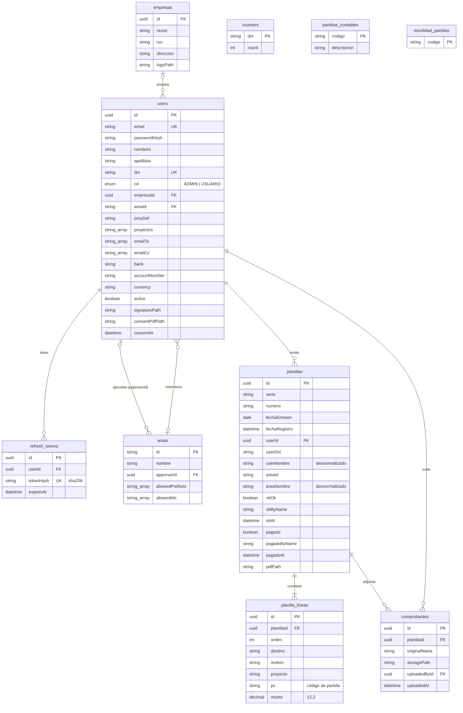

# Modelo de datos

Diagrama entidad-relación generado a partir de `backend/prisma/schema.prisma` (PostgreSQL). Entre paréntesis va el nombre real de la tabla.

## Notas

- `counters`, `partidas_contables` y `movilidad_partidas` no tienen claves foráneas. Se relacionan por valor: `counters.dni` con `users.dni`, y `planilla_lineas.pc` con `partidas_contables.codigo` / `movilidad_partidas.codigo`.
- `planillas.areaId` es texto sin FK (por defecto `""`). Se guarda junto con `areaNombre` como copia del momento de la emisión.
- Restricción única `planillas (userDni, serie, numero)`. Índices en `userId`, `areaId` y `fechaEmision`.
- Al borrar una planilla se borran en cascada sus `planilla_lineas` y `comprobantes`. Al borrar un usuario se borran sus `refresh_tokens`.
- Los campos `*Path` guardan rutas relativas a `STORAGE_ROOT` (`firmas/`, `consentimientos/`, `planillas/`, `comprobantes/` y logos).
