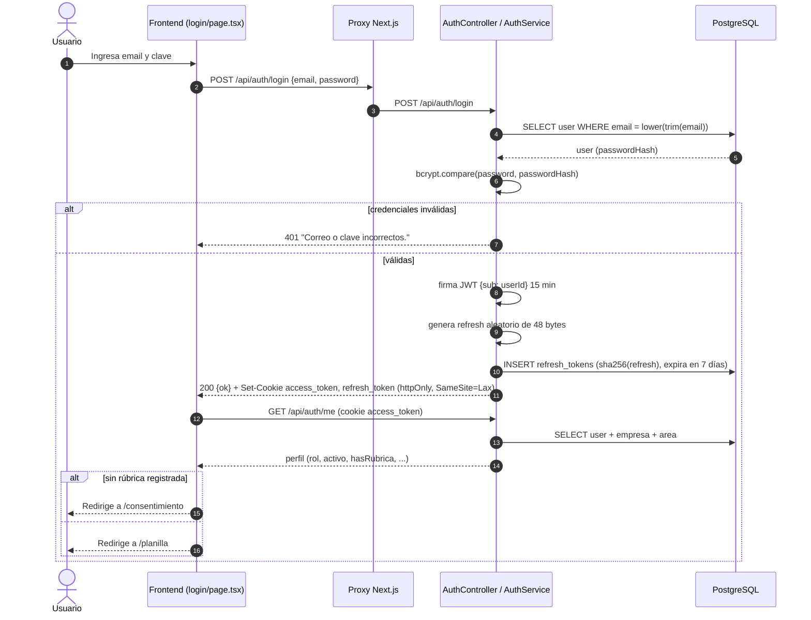
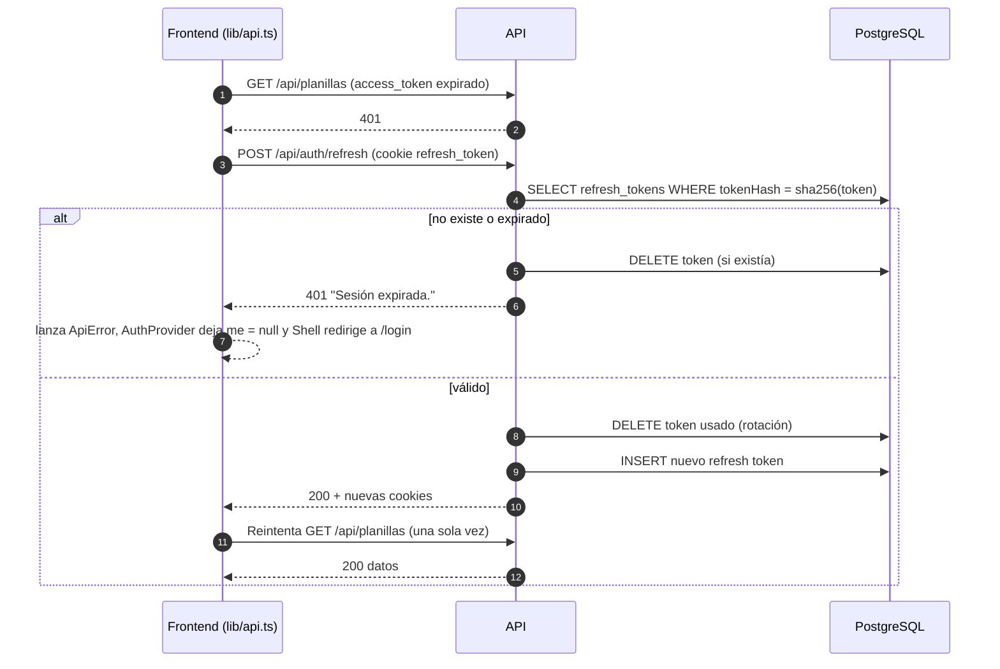
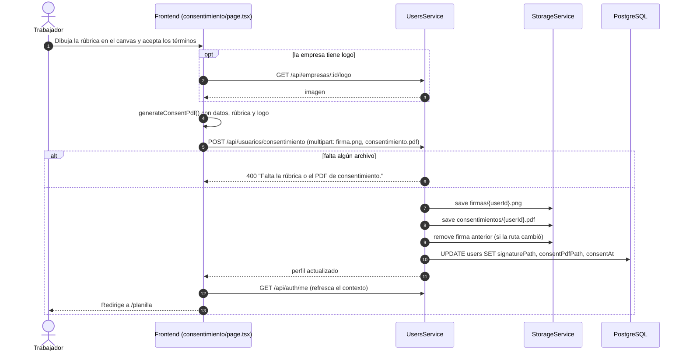
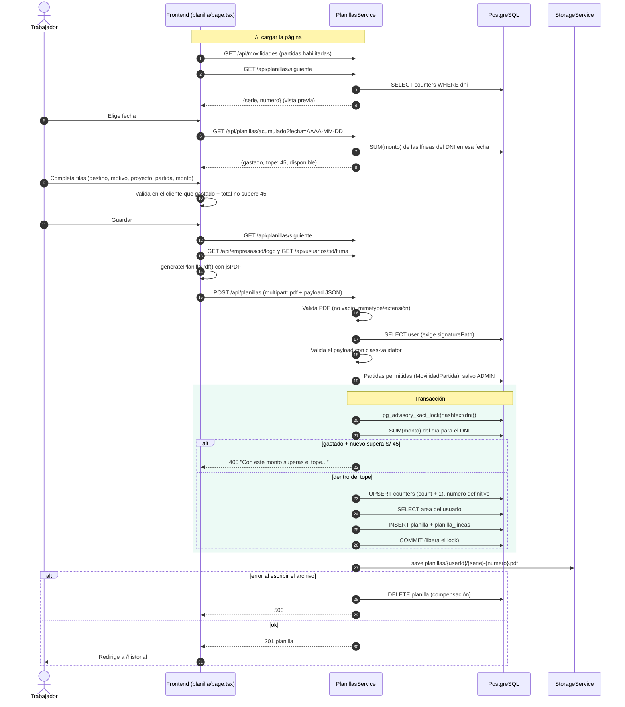
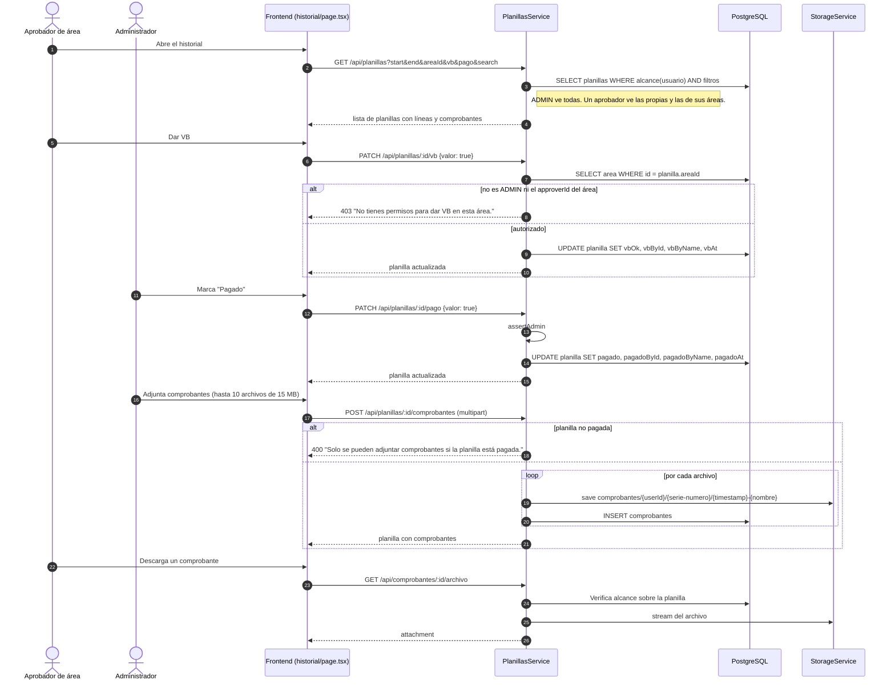
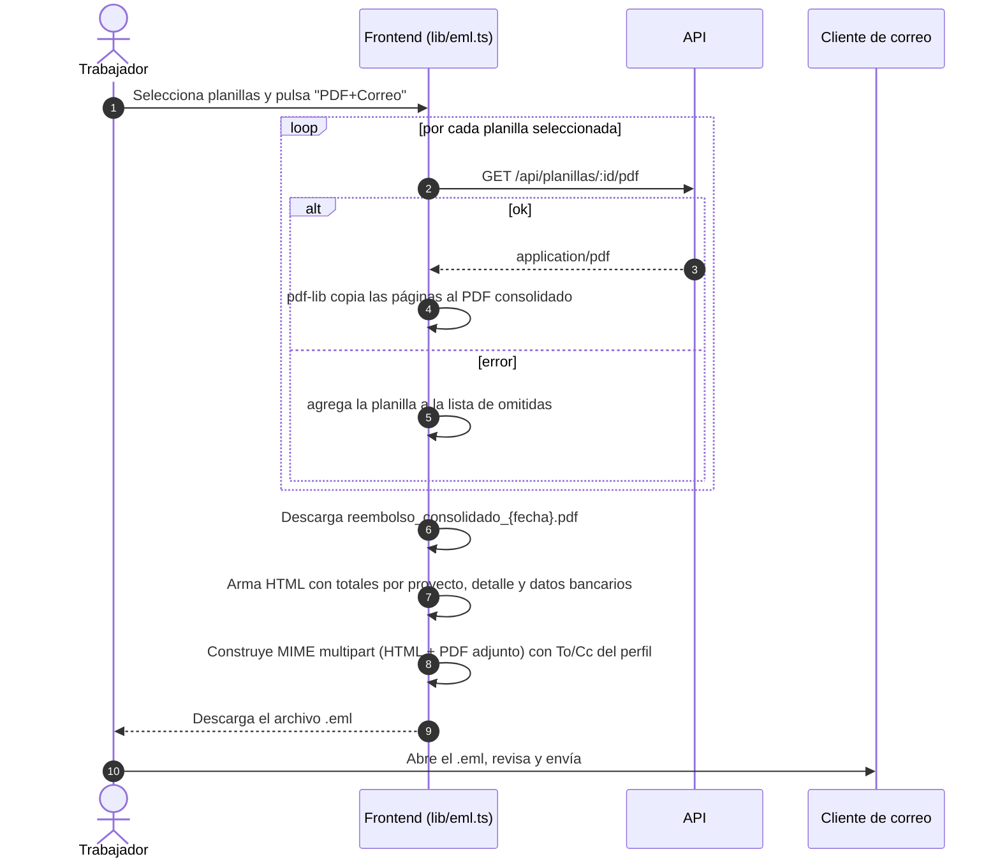

# Diagramas de secuencia

Flujos principales de Planilla Web. Todas las rutas `/api/*` pasan por el proxy de Next.js (`next.config.js`) antes de llegar a la API NestJS. Para simplificar, el proxy se omite salvo en el primer diagrama.

1. [Inicio de sesión](#1-inicio-de-sesión)
2. [Renovación transparente de sesión](#2-renovación-transparente-de-sesión-refresh)
3. [Consentimiento y rúbrica digital](#3-consentimiento-y-rúbrica-digital)
4. [Emisión de una planilla](#4-emisión-de-una-planilla)
5. [V°B°, pago y comprobantes](#5-vb-pago-y-comprobantes)
6. [Exportar PDF + Correo (.eml)](#6-exportar-pdf--correo-eml)

---

## 1. Inicio de sesión

Fuentes: `frontend/app/login/page.tsx`, `frontend/components/AuthProvider.tsx`, `backend/src/auth/auth.service.ts`.

> En cada request protegida, `JwtStrategy` toma el token de la cookie `access_token` (o del header `Bearer`) y vuelve a cargar el usuario desde la BD. `ActiveGuard` rechaza con 403 a los usuarios inactivos.

---

## 2. Renovación transparente de sesión (refresh)

Fuentes: `frontend/lib/api.ts`, `backend/src/auth/auth.service.ts`.

---

## 3. Consentimiento y rúbrica digital

Es obligatorio antes de emitir planillas. `Shell` redirige a `/consentimiento` mientras `hasRubrica` sea falso.
Fuentes: `frontend/app/consentimiento/page.tsx`, `frontend/lib/pdf.ts`, `backend/src/users/users.service.ts`.

---

## 4. Emisión de una planilla

El flujo de negocio principal: el PDF se genera en el navegador y la API valida, numera y aplica el tope diario de S/ 45 por DNI.
Fuentes: `frontend/app/planilla/page.tsx`, `backend/src/planillas/planillas.service.ts`.

> El número que se ve en el PDF sale de `/siguiente` justo antes de enviar. El número definitivo lo asigna el `UPSERT` de `counters` dentro de la transacción, que el lock serializa por DNI.

---

## 5. V°B°, pago y comprobantes

Fuentes: `frontend/app/historial/page.tsx`, `backend/src/planillas/planillas.service.ts`.

---

## 6. Exportar PDF + Correo (.eml)

El sistema no envía correos. El navegador junta los PDFs y genera un `.eml` que el usuario abre en su cliente de correo.
Fuente: `frontend/lib/eml.ts`.

> La exportación a Excel (`xlsx`) del historial también ocurre en el navegador, con los datos que ya devolvió `GET /api/planillas`.
